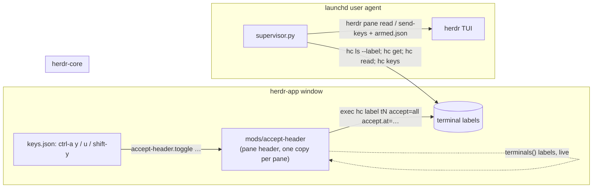

# herdr-app port — design

Date: 2026-11-10
Status: approved in chat, pending written-spec review
Branch: `feat/herdr-app-port` (stacked on `feat/permission-only-mode`)

## Goal

Bring herdr-accept-tool's keybind arming, its `⚡` / `🔐` pane marker and its
prompt answering to the Herdr desktop app (`herdr-app`) and its terminal
server herdr-core (`hc`), while the existing herdr TUI plugin keeps working
until every workspace has moved over.

## Decisions (from the brainstorm)

| Question | Decision |
|---|---|
| Where the armed marker shows | In the pane header, a clone of the shipped `pane` mod |
| What else the header shows | The herdr-core terminal address (`t17`) and the tool icon after the name |
| herdr TUI support | Kept; one supervisor serves both |
| Approach | A: shared Python core, `hc` backend, terminal labels as state, header mod as UI |

Rejected: porting the parser to a JS mod (mods stop when the window closes
while herdr-core agents keep running; the parser and its four test files would
be rewritten), and keeping core arming in `armed.json` (needs pruning, and a
reused terminal address could inherit a stale entry).

## Facts this design relies on

Verified on this machine against herdr-app with herdr-core 0.1.19, 2026-11-10:

- `hc ls --json --label K=V` lists only live terminals carrying that label.
- `hc get <t>` returns `labels` and `foreground.argv` (the program in front, e.g.
  `["claude", "--resume", "…"]`).
- `hc label <t> key=value` sets a label; `hc label <t> key=` removes it. Labels go
  away with the terminal.
- `hc read <t>` prints the screen; `hc keys <t> <names…>` presses named keys
  (`enter`, `esc`, `tab`, `up`, `ctrl+c`, `a`, …).
- The `main` layout already frames every pane with a header:
  `pane.header = {content: {mod: "pane"}, height: 30, position: "top", reveal: "always"}`
  (`~/.config/herdr-app/layouts/main.json`). The shipped `pane` mod draws the program
  icon, the program or title name, and the folder.
- A key in `keys.json` can send `<mod>.<command>`; it reaches only copies of that
  mod that are on screen. A pane-header mod has one copy per pane of the shown tab,
  so the focused pane's copy is always there.
- Shipped mods and layouts are replaced at app start; a copy (`mod.clone`,
  `layout.clone`) or an edit (`<name>-edited`) is what survives.

To verify during implementation (not yet checked):

- `hc keys` accepts `space` and `down` as names (the help lists `up`, `tab`,
  `enter`; `down` was accepted in a probe).
- Whether herdr-app loads a mod from a symlinked folder under `mods/`; if not, the
  install step copies it.

## Architecture



### 1. Backend seam (Python)

`herdr_accept_tool.py` keeps the parser, `prompt_kind`, `choose_option` and
`keys_for` unchanged. The two I/O calls move behind a small protocol:

```python
class Backend(Protocol):
    def read_screen(self, target: str, lines: int) -> str: ...
    def send_keys(self, target: str, keys: Sequence[str]) -> None: ...
```

- `TuiBackend`: today's `herdr pane read … --source visible` and `herdr pane send-keys`.
- `CoreBackend` (new `scripts/core_api.py`): `hc read <t>` and `hc keys <t> …`.
  `keys_for` keeps producing TUI names (`Down`, `Up`, `Enter`, `Tab`, `Space`, `y`);
  `CoreBackend` maps them to `hc` names (`down`, `up`, `enter`, `tab`, `space`, `y`).
- `Answerer` takes a `backend` field instead of calling the module functions.
- The herdr-core CLI is found as `hc`, else `herdr-core`
  (override `HERDR_CORE_BIN`).

CLI target forms: `w26:p4D` or an agent name stays TUI; `core:t17` is herdr-core.

### 2. herdr-core arming state: terminal labels

| label | value | meaning |
|---|---|---|
| `accept` | `all` \| `permissions` | armed, and in which mode |
| `accept.at` | epoch seconds | when it was armed (TTL is applied by the supervisor) |

The TUI keeps `~/.local/state/herdr-accept-tool/armed.json` exactly as today.
The supervisor owns the TTL (12 h, `HERDR_ACCEPT_TTL`) for both, so the mod
never needs to know it.

A closed terminal takes its labels with it: no prune step, no address reuse risk.

### 3. Supervisor

Each cycle:

1. Touch the heartbeat. It now also writes the epoch as file content, so the
   mod can read it with `readTextFile` (mods cannot `stat`).
2. TUI source: unchanged (`armed.json`, `herdr pane list`, `pane process-info`).
3. Core source: `hc ls --json --label accept=all` and `--label accept=permissions`,
   then `hc get` per armed terminal for `labels` and `foreground.argv`.
4. Both feed `plan_cycle` with keys namespaced `tui:<pane>` / `core:<address>`.
   Process for core is the basename of `foreground.argv[0]`.
5. Expired core terminals: remove `accept` and `accept.at`. The header marker
   disappears live; the supervisor logs it (no toast: only the app can draw one).
6. Each source backs off on its own when unreachable; one being down does not
   stop the other.

### 4. `accept-header` mod (herdr-app)

A clone of the shipped `pane` mod, kept in this repo under `herdr-app/accept-header/`
and installed into `~/.config/herdr-app/mods/accept-header`.

Header, left to right: program icon, name, ` · t17` (dim), the tool icon, folder,
status, hover buttons (unchanged).

| state | tool icon | click |
|---|---|---|
| off | none (a dim `○` on hover) | arm all |
| all | `⚡` | switch to permissions |
| permissions | `🔐` | disarm |

Commands from `keys.json`, acted on only by the copy whose `props().pane` is
`focused().pane`:

| key | command | effect (matches the TUI plugin) |
|---|---|---|
| `ctrl-a y` | `accept-header.toggle` | off → all; all → off; permissions → all |
| `ctrl-a u` | `accept-header.toggle-permissions` | off → permissions; permissions → off; all → permissions |
| `ctrl-a shift-y` | `accept-header.disarm-all` | remove the labels from every armed terminal |

Every arm or disarm shows a `notify()` toast. Arming adds a warning to the toast
when the heartbeat is older than 15 s (supervisor not running).
State is read from `terminals()` (live), never polled.

Layout: point the `main` layout's `pane.header.content.mod` at `accept-header`
(the app keeps the edit as `main-edited`). Trade-off: later changes Herdr ships
to `main` do not reach the edited copy.

### 5. Install

- `scripts/install-herdr-app.sh`: place the mod, set the header in the layout, add
  the three keys to `keys.json` (merge, never overwrite other keys), then run
  `herdr-app check` on the mod. `--uninstall` reverses each step.
- launchd install is unchanged (same supervisor, now serving both).

## Error handling

| failure | behaviour |
|---|---|
| `hc` missing or herdr-core down | core source backs off 5→60 s; TUI source unaffected |
| `hc get` fails for one terminal | skip it this cycle, log once |
| foreground is not `claude` / `agy` / `antigravity` | armed but idle, as today |
| `hc label` from the mod fails | toast with the error; marker stays as it was |
| the mod is not shown (another layout) | keys do nothing; the supervisor still answers armed terminals |

## Safety

Unchanged from the TUI plugin: only known agent processes get key presses, every
armed terminal expires after the TTL, every answer is logged to
`~/.local/state/herdr-accept-tool/supervisor.log`. Both modes approve any
permission the agent asks for, including shell commands; `🔐` only keeps the
agent's questions for the person.

## Testing

- Existing suites stay green, with the backend injected as a fake.
- New `tests/test_core.py`: key-name mapping; parsing captured `hc ls --json` and
  `hc get` output; `plan_cycle` over core terminals (label expiry, non-agent
  foreground idles, a vanished terminal is dropped without a label write).
- `herdr-app check ~/.config/herdr-app/mods/accept-header` passes.
- Live: arm `t17` with `ctrl-a y`, see `⚡` and `· t17` in its header, trigger a
  Claude permission prompt, and find the answer in `supervisor.log`; `ctrl-a u`
  shows `🔐` and leaves an `AskUserQuestion` dialog on screen.

## Out of scope

- Terminals on other machines (`mac-mini-tvf/t1`): addresses may just work
  through `hc`, but this is not tested or promised.
- Parser changes.
- Removing the herdr TUI plugin.
